 

 

  

I design, build and run products end to end, on my own: the React Native app, the Node API, the database, the payments, the deploy. Most of what I make is for people in Nigeria and across Africa, so it's built for Naira pricing, Paystack, busy networks and the phones people actually carry.

 

<b>More work, with links</b>

 

| Project | What it is | Link |
|---|---|---|
| **Ikorodu Market Fair** | Marketplace for a local fair: product listings, vendor sign-up, events | [ikdmarketfair.com](https://www.ikdmarketfair.com) |
| **Vaayak Equipments** | Site for a Nigerian mining, energy and oil and gas procurement company | [vaayak.com](https://www.vaayak.com) |
| **FlowPay** | Recurring payments with automatic subscription billing on Paystack | [flowpay-khaki.vercel.app](https://flowpay-khaki.vercel.app) |
| **Vozia** | PDF converter and AI study companion for Android | [Play Store](https://play.google.com/store/apps/details?id=com.renbostudios.vozia) |

 

### The toolbox

plus Expo, React Native, Socket.IO, Paystack, Cloudinary and WebRTC in production

 

 

### Right now

- **Roomie** is heading to the Play Store: roommate matching with chat, voice notes, games and a points economy
- **TradeMe** is getting live market data for paper trading
- Going deeper on DevOps and cloud
- Open to freelance work and serious collaborations, so say hi

 

The cards above are drawn from my live GitHub data and refresh every day.

